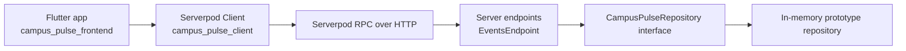

# Campus Pulse: Frontend and Backend

This workspace contains two independent Dart projects connected by the generated Serverpod client package:



## Folder Map

- `campus_pulse_frontend/` is the existing Flutter app. Its screens and navigation remain in place; backend access is isolated in `lib/campus_pulse_api.dart` and the presentation uses generated protocol models through adapters.
- `campuse-pulse-backend/campus_pulse/campus_pulse_server/` is the Serverpod 4.0.4 server. Handwritten model definitions (`*.spy.yaml`), endpoint code, and repository implementations are under `lib/src/`.
- `campuse-pulse-backend/campus_pulse/campus_pulse_client/` is generated by `serverpod generate`. The frontend depends on this directory using a local path dependency declared in `campus_pulse_frontend/pubspec.yaml`.

## Current API Flows

- Explore calls `client.events.list()`.
- An event route calls `client.events.get(eventId)`.
- Register calls `client.events.register(eventId, prototypeStudentId)`.
- My Activity calls `client.events.myRegistrations(prototypeStudentId)`.
- Organizer event creation calls `client.events.create(...)`.
- Study Buddy scoring and reasons are available from `client.events.matchStudyBuddies(...)`; the existing buddy UI still uses its demo data for now.

The Serverpod endpoint delegates to `CampusPulseRepository`. Its current implementation is `InMemoryCampusPulseRepository`, which seeds eight events and three buddy profiles. **This is temporary in-memory data. Registrations and organizer-created events reset when the server process restarts. No PostgreSQL database, credentials, migrations, or persistent storage are configured.** The `prototypeStudentId` is a demo grouping value, not authentication or a secure identity.

## Run Locally

1. In `campuse-pulse-backend/campus_pulse/campus_pulse_server`, run:

   ```powershell
   serverpod start
   ```

   The development API listens on port `8080`. Database configuration has intentionally been omitted.

2. In `campus_pulse_frontend`, run:

   ```powershell
   flutter pub get
   flutter run
   ```

The Flutter client defaults to `http://localhost:8080/` for desktop/web and `http://10.0.2.2:8080/` for the Android emulator. A physical phone must use the development computer's LAN IP and be on a network that permits the connection. Override the address at launch, for example:

```powershell
flutter run --dart-define=CAMPUS_PULSE_SERVER_URL=http://192.168.1.25:8080/
```

Replace the sample IP with the host computer's reachable LAN address. Ensure the OS firewall allows inbound access to port `8080`. `localhost` on a physical phone refers to the phone itself.

## Generated Code

Edit only the model YAML files, handwritten endpoints, and repository code. Do not edit `campus_pulse_server/lib/src/generated/` or the generated client package by hand. From the server package, regenerate after model or endpoint changes:

```powershell
serverpod generate
```

This updates server protocol/endpoint registration and the client methods/models. The Flutter local path dependency points at that client, so the app imports those generated types directly.

## Replacing the Temporary Repository with PostgreSQL Later

1. Keep `CampusPulseRepository` as the endpoint-facing boundary. Add a PostgreSQL-backed implementation with the same operations and select it through server setup or dependency injection; endpoint request and response shapes can remain stable.
2. Add persistence keys/relations and appropriate `table:` declarations to the serializable model definitions, or define dedicated database row models if API DTOs should stay separate. Likely tables include events, event registrations, student/study-buddy profiles, plus organizer ownership and any match-request records you decide to persist.
3. Add database constraints, especially a unique constraint/index for `(eventId, studentId)`, and foreign keys from registrations to events and profiles. Keep duplicate prevention in the repository as well so callers get a useful API error.
4. Configure PostgreSQL host, port, database name, user, SSL as appropriate, and secrets/passwords through Serverpod's environment-specific configuration and secret management. Do not commit credentials.
5. Generate and review Serverpod migrations, apply them in the target environment, and add integration tests against the configured test database. None of these schema/config/migration steps has been performed in this prototype phase.
6. Replace only the repository implementation and relevant wiring, then rerun the endpoint/client tests. If the public model fields change, regenerate the Serverpod client and update the Flutter adapters as needed.

## Verification Scope

The backend repository unit tests can run without Serverpod startup or PostgreSQL:

```powershell
cd campuse-pulse-backend/campus_pulse/campus_pulse_server
dart test test/unit/in_memory_campus_pulse_repository_test.dart
```

The client-server network path requires starting the Serverpod process and then launching the Flutter app with a reachable server URL.
